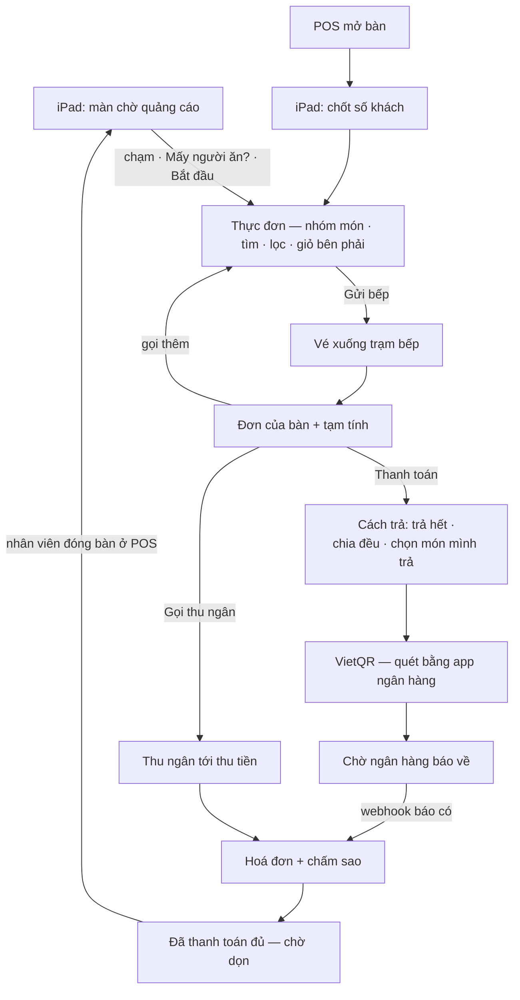

# 4 · Sora Table — khách gọi món trên iPad gắn bàn & tự thanh toán

Mỗi bàn có một **iPad 10,2″ gắn đế, nằm ngang**, ghép sẵn vào đúng bàn đó (lắp đặt:
[THIET-BI.md](../THIET-BI.md)). Khách không cài gì, không quét gì: ngồi xuống là gọi
món được. Chương này để phục vụ và thu ngân hiểu khách đang thấy gì mà hướng dẫn — và
biết ranh giới nào là cố ý.

> Luồng cũ "khách quét mã QR bằng điện thoại" **đã bỏ** (22/10/2026). POS không còn
> nút **Mã QR bàn**.

## 4.1 Màn chờ và mở bàn

Bàn trống thì iPad chiếu **màn chờ quảng cáo**: ảnh và video marketing bật cho iPad ở
Office A8 (tab W1, cờ **Chiếu trên iPad tại bàn**), mỗi ảnh 7 giây, chữ lớn như hero trang
chủ; chưa bật khung nào thì chiếu món ký của bếp. Góc phải dưới là số bàn và nút vàng
**Chạm để bắt đầu gọi món** — chạm chỗ nào trên màn cũng được. Mở hộp ra mà để yên 60
giây thì iPad về lại màn chờ.

Hai cách mở bàn, kết quả như nhau — iPad luôn đi theo **phiên của bàn**:

1. **Khách tự mở trên iPad.** Chạm màn chờ → hộp **Chào mừng quý khách** →
   khách chọn **Mấy người ăn?** (1–6, hoặc **Khác** để nhập số) → **Bắt đầu gọi món**.
   Ô bàn trên sơ đồ POS chuyển `Có khách` ngay.
   - Nhóm **đông hơn sức chứa bàn**: bàn vẫn mở (ghi đúng sức chứa) và POS nhận yêu
     cầu *"Nhóm N khách — cần ghép thêm bàn cạnh bàn X"* ở **Yêu cầu từ bàn**.
   - Bàn **có khách đặt trong 90 phút tới**: nút vàng ở màn chờ đổi thành *"Bàn đã có khách
     đặt lúc HH:MM"*; chạm vào, iPad không mở mà chỉ báo *"Bàn này được giữ cho khách đặt
     lúc HH:MM"* (không bao giờ hiện tên người đặt) và mời gặp nhân viên. Đúng khách đặt thì
     nhân viên mở bàn ở POS (từ đặt chỗ); khách khác thì xếp bàn khác.
2. **Nhân viên mở ở POS** (P3) như cũ. iPad thấy bàn đã mở trong vài giây và hỏi lại
   **Mấy người ăn?** với số nhân viên đã nhập — khách sửa nếu sai (số này đi vào báo
   cáo bình quân đầu khách).

Hai người cùng mở một lúc (khách chạm đúng lúc nhân viên mở ở POS) không sinh hai bàn —
iPad vào đúng phiên vừa mở.

## 4.2 Sơ đồ luồng của khách

## 4.3 Gọi món

- **Thanh trên:** `TOKYO SORA` · bàn + khu + số khách · **Gọi nhân viên** · **Đơn của
  bàn** kèm tổng tiền tới giờ.
- **Thực đơn (T2):** cột trái là các **nhóm món** (kanji + tên + số phần đang chọn),
  giữa là lưới ba cột thẻ món, phải là cột **Món đang chọn**. Nút **`+`** thêm thẳng vào
  giỏ (nhãn +1 bay vào cột giỏ); món phải chọn vị/số người ăn có **chấm kem** — bấm `+`
  là mở chi tiết. Món hết đóng dấu **Đã hết**, xám, không ẩn. Món khuyến mãi có nhãn và
  giá gốc gạch ngang.
- **Tìm món (T4) và Bộ lọc (T5)** ở đáy cột nhóm, mở ngay trong cột giữa. Gõ không dấu
  vẫn ra ("bo ba chi" → Ba chỉ bò). Bộ lọc: Chay · Không cay · Không hải sản · Dưới 200k
  · Đang có sẵn.
- **Chi tiết món (T3):** hộp hai cột — trái là món (ảnh, tên, giá, dị ứng), phải là
  tuỳ chọn (nhóm bắt buộc chọn sẵn lựa chọn đầu), ghi chú cho bếp, số lượng. Món có bài
  kể có nút **Bí quyết thưởng thức**.
- **Giỏ (T6–T7):** sửa số lượng từng dòng, ô ghi chú chung cho bếp, **Tạm tính đợt
  này** → **Gửi bếp**. Gửi xong cột giỏ tóm tắt đợt vừa gửi hai giây rồi trống lại.
- **Đơn của bàn (T8 + T10):** nhóm theo **lượt gửi bếp**, mỗi món có trạng thái
  `Bếp đã nhận → Đang làm → Sắp ra → Đã ra` (món huỷ gạch ngang); bên phải là tạm tính
  (tiền món, khuyến mãi, phí phục vụ, VAT, làm tròn) với hai nút **Thanh toán** và
  **Gọi thu ngân**.
- **Gọi nhân viên (T9)** — nút trên thanh trên ở mọi màn: **Gọi phục vụ · Thêm than**
  (chỉ bàn có bếp) **· Đá · nước · Xin tính tiền · Việc khác** → hiện ở màn *Yêu cầu từ
  bàn* (P12) của POS.
- **Để yên 3 phút** (giữa bữa): màn tối lại, chỉ còn tổng đơn và số phần đang chọn chưa
  gửi; chạm là trở lại đúng chỗ — không bao giờ quay về màn chào giữa bữa.

## 4.4 Tự thanh toán

- **Cách trả (T11):** **Trả hết** · **Chia đều** (chọn mấy người; mỗi người lần lượt
  quét mã phần mình trên chính iPad này) · **Chọn món mình trả** (T12 — món người khác
  đã nhận trả bị khoá, chống trả trùng). Số tiền lượt này đổi ngay theo lựa chọn.
- **VietQR (T13):** mã QR + số tài khoản và số tiền (có nút chép). Màn chờ *"Đang chờ
  ngân hàng báo về…"*, thường dưới một phút; lâu hơn thì *"Lâu hơn thường lệ"* — nhân
  viên tới xác nhận giúp.
  - Khách chuyển **lệch tiền**: *"Nhân viên sẽ tới đối chiếu giúp bạn — chưa cần chuyển
    thêm."* → thu ngân xử lý ở màn đối soát P15 (**Chấp nhận** / **Yêu cầu bù**).
  - Lượt trả **hết hạn**: *"Tạo lại mã mới giúp bạn, tiền chưa bị trừ lượt này."*
- **Hoá đơn (T15):** phiếu đủ món (món khuyến mãi in giá gốc + dòng giảm), phí, thuế,
  các lượt trả. Bàn còn nợ thì ghi rõ *"đây vẫn là bản tạm tính"*. Bên phải là thẻ
  **chấm sao** — đổ về màn *Phản hồi khách* (B13) trên Office.
- **Trả đủ:** iPad hiện **Đã thanh toán đủ** — *"Nhân viên sẽ dọn bàn trong ít phút"*,
  kèm **Xem hoá đơn · Gọi thêm món · Gọi nhân viên**.

## 4.5 Đóng bàn và đổi lượt khách

- **Nhân viên đóng bàn ở POS** (sau khi trả đủ, hoặc bàn 0đ) → iPad về **màn chờ quảng
  cáo** trong vài giây, dù đang đứng ở màn nào.
- Có bản phần mềm mới thì iPad tự tải lại **chỉ khi đang ở màn chờ** — không bao giờ giữa
  bữa.
- Đổi lượt khách là **xoá sạch** dấu vết khách trước trên iPad: món chọn chưa gửi, các
  lượt trả, từ khoá tìm gần đây. Đơn của bàn trước chỉ còn xem được ở POS.
- iPad bị **ngắt ở Office → A4** thì về màn **Ghép iPad với bàn** — nhờ quản lý sinh mã
  mới (chương 6, A4).

## 4.6 Quy tắc an toàn & sự cố

| Tình huống | Hành vi của hệ thống |
|---|---|
| Khách bấm "Đã chuyển xong" nhưng chưa chuyển | Không có gì đổi — **chỉ webhook ngân hàng báo có mới ghi nhận tiền** |
| Bàn trả đủ | Bàn chuyển *Đã trả · chờ dọn*; **nhân viên đóng bàn**, không tự đóng; khách vẫn gọi thêm được (khoản mới cùng phiên) |
| Mất mạng khi đang gọi món | Giỏ vẫn thao tác được, ảnh món vẫn hiện (iPad tải sẵn lúc bàn trống), món **tự gửi khi có mạng** (dải báo "Mất kết nối — bạn vẫn chọn món được, món sẽ tự gửi bếp khi có mạng") |
| Bật iPad lúc mất mạng | App vẫn lên, báo *"Chưa nối được máy chủ. Kiểm tra Wi-Fi của iPad rồi thử lại."* và tự nối lại khi có mạng |
| Mất mạng khi thanh toán | **Chặn hẳn**: *"Thanh toán cần mạng ổn định. Vui lòng gọi thu ngân."* — lượt trả cần tài khoản định danh thật, không xếp hàng được |
| Mất mạng khi mở bàn | Báo *"Mất kết nối — chưa mở được bàn. Vui lòng gọi nhân viên."* — nhân viên mở ở POS |
| Bếp báo hết món đang nằm trong giỏ | Hộp thoại báo món vừa hết, bỏ khỏi giỏ và gợi ý hai món thay (T16) |
| Office vừa ngừng bán món đang nằm trong giỏ (M1) | Gửi bếp bị từ chối: *"{món} hiện không bán ở chi nhánh này"* — bỏ món đó khỏi giỏ rồi gửi lại |
| Khách gọi nhân viên khi mất mạng | Báo lỗi thẳng (gọi người thì không thể nằm chờ trong hàng đợi) |
| Khách muốn mở bàn khác hay xem đơn bàn khác | Không làm được — iPad chỉ thấy đúng bàn được ghép |

## 4.7 Chưa có trong bản dựng này

- Chọn ngôn ngữ **VI / EN / JA**.
